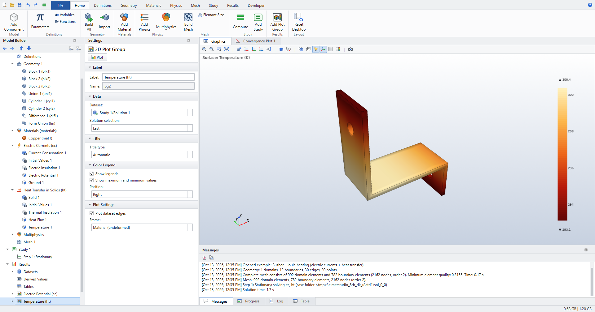
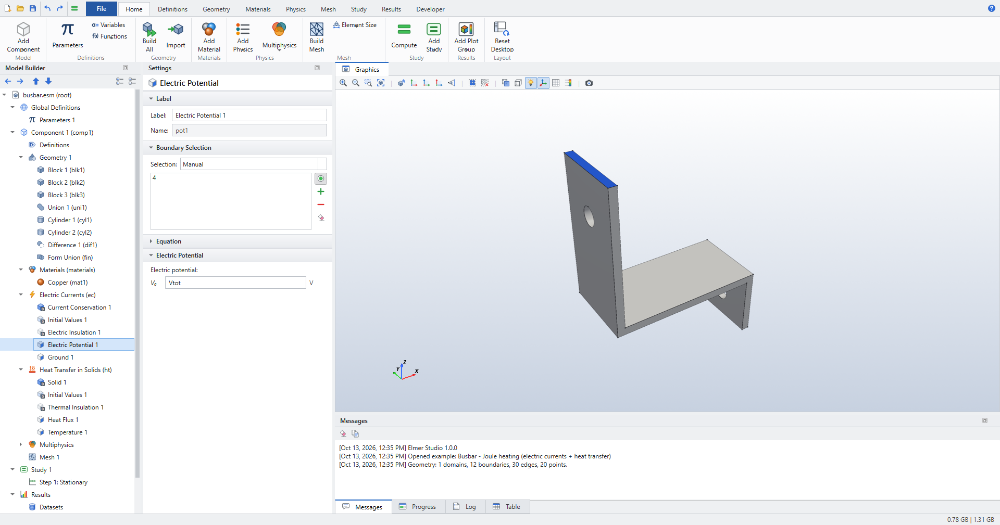
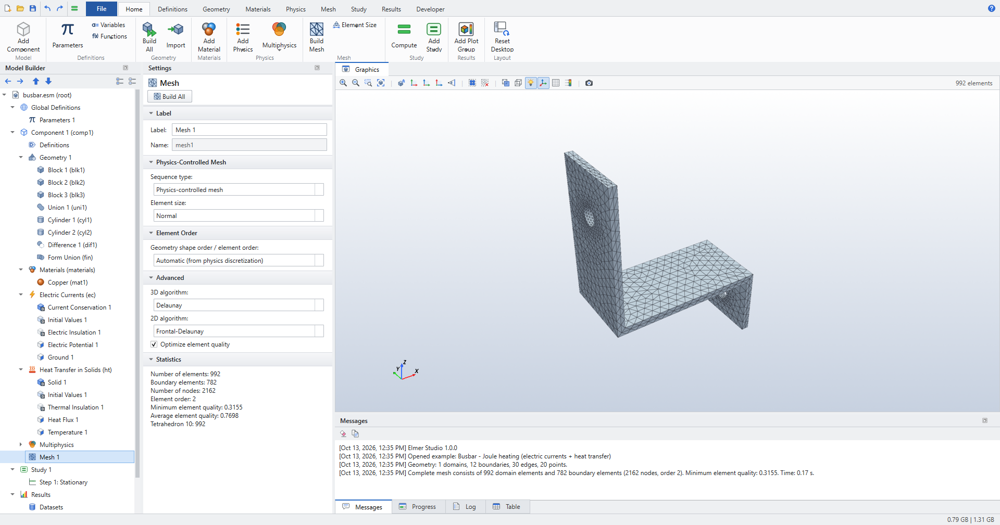
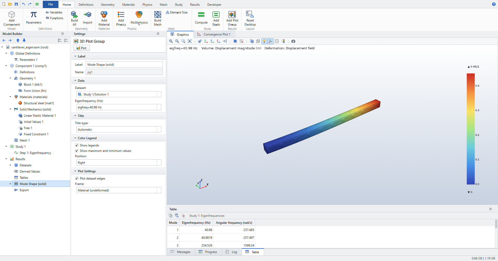
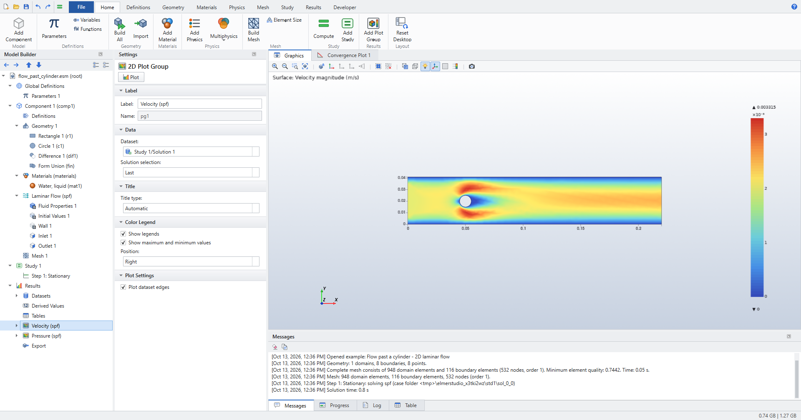
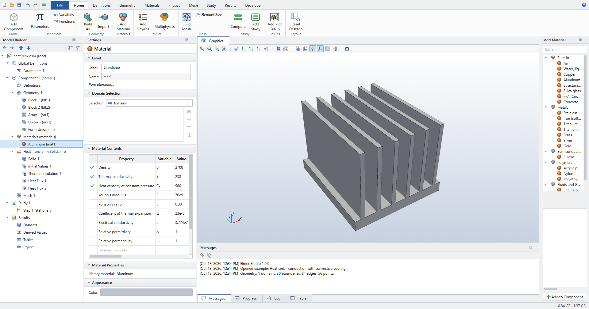
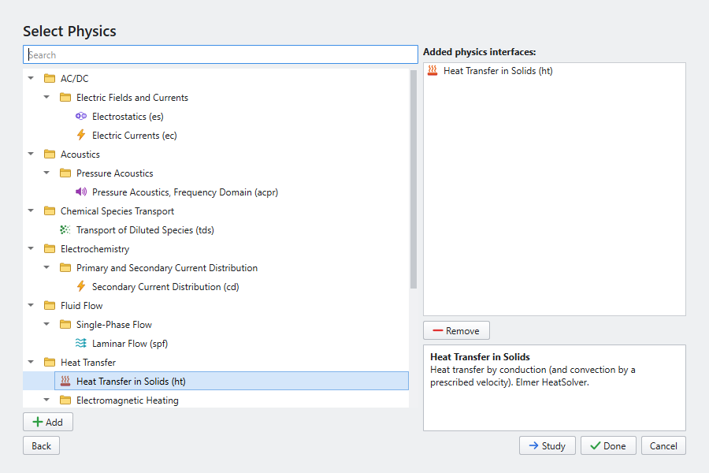

# Elmer Studio

A desktop model builder for the open-source **Elmer FEM** multiphysics solver, built around the
workflow and layout of COMSOL Multiphysics: the Model Builder tree, Settings windows, ribbon,
Graphics window with entity selection, Model Wizard, material library, studies and results.
Elmer Studio is an independent project. It is not affiliated with COMSOL AB, and it uses
original icons and no COMSOL assets.

**Documentation: <https://altelmer.github.io/ElmerStudio/>** covers installation, a quick start, tutorials, the user guide, keyboard shortcuts and a complete settings reference. The source is AsciiDoc in [`docs/`](docs/); see *Contributing* in the docs for building it.



| | |
|---|---|
|  |  |
|  |  |
|  |  |

## Download

Prebuilt portable bundles and installers (Windows setup + portable zip, macOS .dmg, Linux AppImage + tarball) are attached to each [GitHub Release](https://github.com/AltElmer/ElmerStudio/releases); every build is self-tested by launching the frozen app (and solving/plotting when Elmer is present). The packages do **not** include Elmer itself — install it separately (below). macOS builds are unsigned: right-click > Open the first time.

## Run it from source

Requirements: Python 3.10+ and an Elmer installation (ElmerSolver). Nothing depends on a particular GPU or
vendor library. The solver runs on the CPU, and graphics need any OpenGL 3.2 driver; see *Graphics without a GPU* below for the software fallback.

```bash
# Windows: double-click run_elmerstudio.bat   (creates .venv on first run)
# Linux/macOS:
./run_elmerstudio.sh
# or manually
python -m venv .venv && .venv/bin/pip install -r requirements.txt
.venv/bin/python -m elmerstudio                      # New window (Model Wizard / Blank Model / examples)
.venv/bin/python -m elmerstudio --example busbar     # open an Application Library example
.venv/bin/python -m elmerstudio model.esm            # open a saved model
```

**Elmer** is located automatically from `ELMER_HOME`, `PATH` or standard install folders, and can be set in
*File > Preferences*. You can get it from:

- Windows: the prebuilt installers at <http://www.nic.funet.fi/pub/sci/physics/elmer/bin/windows/>.
- Ubuntu/Debian: `ppa:elmer-csc-ubuntu/elmer-csc-ppa` → `apt install elmerfem-csc`.
- macOS: Homebrew or a source build.

To run on several cores, set *Study > Number of MPI processes*. This needs an MPI build of Elmer (`ElmerSolver_mpi` plus `mpiexec`); the mesh is partitioned with ElmerGrid.

## COMSOL tutorials reproduced

The two step-by-step models of *Introduction to COMSOL Multiphysics* are rebuilt with the same workflow and checked against what the tutorial text states (`tests/test_tutorial_busbar.py`, `tests/test_tutorial_wrench.py`, GUI walkthrough `tools/screenshot_tutorial.py`):

| Tutorial | Workflow in Elmer Studio | Checked |
|---|---|---|
| **Busbar** (Joule heating) | xz work plane: rectangles, Difference, Fillet on *point 3* (r = tbb) and *point 6* (r = 2·tbb), Extrude wbb; face-parallel work planes on faces 8 and 4 with circles, Copy, Extrude −2·tbb; Copper + Titanium beta-21S; Electric Potential / Ground on the bolt faces; convective Heat Flux (htc) elsewhere; user mesh (mh, mh−mh/3, curvature 0.2); Parametric Sweep wbb = range(5,1,10) cm; Average coupling operator `aveop1(T)` in a Global Evaluation and a 1D Global plot | 7 domains ("domains 2–7 are the bolts"); temperature spread < 10 K; top bolt hottest; average temperature falls with width; Joule power = convective loss (0.4 %) |
| **Wrench** (stationary solid mechanics) | geometry from parameters (COMSOL's `wrench.mphbin` is not public); Fixed Constraint on the socket; Boundary Load as **Total force** −F (150 N); von Mises plot, safety plot `solid.mises > 200[MPa]`, Volume Maximum / `maxop1`; mesh-convergence sweep on `hd` with Size hmax = h0/hd, hmin = h0/(4·hd), curvature 0.1, narrow regions 0.2 | mesh refines with hd; tip deflection converges (3.100 → 3.117 mm) and agrees with beam theory; peak stress located at the handle/head corner |

Features added while following them: face-parallel and all quick work planes (xy, yz, zx, yx, zy, xz); 2D Fillet/Chamfer on clicked vertices; the plane sketch and the "geometry so far" shown with entity labels while picking; component couplings (Average, Integration, Maximum, Minimum); Global Evaluation and Global plots over a parametric sweep (parameter in its own unit); Max/Min with location; Total force loads; Multislice plots; COMSOL's definition of *resolution of narrow regions*.

### Essentials of Postprocessing and Visualization

The guide's own models are COMSOL files, so stand-ins carry the same workflow (`tests/test_tutorial_postprocessing.py`, GUI walkthrough `tools/screenshot_postprocessing.py`, screenshots `docs/modules/ROOT/images/screenshots/tutorial_post_*.png`):

| Walkthrough | Workflow in Elmer Studio | Checked |
|---|---|---|
| **Pulley** (2D plane stress, spinning) | Rotating Frame with Ω = `n[rpm]`; Parametric Sweep over n; Surface Maximum of displacement (mm) and von Mises stress (MPa) over the sweep; Cut Point (19, 54) mm with a Point Graph; Point Evaluation on two clicked geometry points; Integration couplings on the far-right and far-left points (point level), variable `diam = intop1(R+u) - intop2(-R+u)`, Global Evaluation of `diam - 2*R`, Table Graph | every result scales with n²; point values outward on both sides; `diam - 2R` equals the point-value difference to 1e-9 |
| **Rotating annulus** (verification) | quarter annulus, rollers, Rotating Frame | hoop stress at the bore within 0.7 % and rim displacement within 0.01 % of Lamé's plane-stress solution |
| **Heat sink** (3D) | wireframe surface, isosurfaces, streamlines started on selected boundaries (tubes/ribbons), Cut Plane dataset in a 2D plot group with grid arrows, Parametric Extrusion of the cut plane over a sweep | linear-temperature block: cut-plane values exact, plane area exact, extrusion volume and mean exact |
| **Revolution and polar plots** (2D axisymmetric coil) | Revolution 2D dataset (start −90°, 225°, layers) with a domain Selection subnode; Polar Plot Group with a Line Graph (Polar) on an evaluation circle | polar values of a field linear in x reproduce `cos θ` exactly |

Added for these: datasets Cut Plane, Parametric Extrusion 2D, Revolution 2D and Mirror (chainable, e.g. a mirrored cut plane); Point Graph, Table Graph, Polar Plot Group, Annotation with `eval(expr, unit)`; Selection and Color Expression subnodes; surface uniform coloring and wireframe; symmetric color ranges; slice planes by coordinates with shift; filled/line/tube contours with level labels; arrow placement on a grid with normalized lengths; streamline tubes/ribbons and start-point control; colored and tube line plots; line styles and markers for 1D graphs; legends with optional max/min; derived values named after the space dimension (*Surface Maximum* in 2D); circles built from four arcs with vertices at 0°, 90°, 180° and 270°, as in COMSOL; parameters and Definitions variables usable in result expressions.
### Acoustics: loudspeaker isosurfaces, BEM-style postprocessing, spherical scatterer

From the Essentials guide (*vented loudspeaker enclosure*) and the blog post *How to Use the Boundary Element Method in Acoustics Modeling* (`tests/test_tutorial_acoustics.py`, GUI walkthrough `tools/screenshot_acoustics.py`, screenshots `docs/modules/ROOT/images/screenshots/tutorial_acoustics_*.png`; both models are in the Application Libraries):

| Walkthrough | Workflow in Elmer Studio | Checked |
|---|---|---|
| **Pulsating sphere** (verification) | Normal Acceleration on the sphere, **Spherical Wave Radiation** on the outer boundary, **Exterior Field Calculation** | in-mesh pressure within 0.2 % of ρc·u·ika/(1+ika)·(a/r)·e^(−ik(r−a)); exterior field 5× beyond the mesh within 1.5 % (axisymmetric) and 2 % (3D, λ/5 mesh) |
| **Spherical scatterer** (BEM benchmark) | rigid sphere, incident plane wave entering through Spherical Wave Radiation (total-field formulation), result variables `acpr.p_s`, `acpr.Lp_s`; Revolution 2D plot; polar Radiation Pattern of the scattered field | scattered field within 5 % of the analytic series at ka = 2.3 and 6.4; scattered SPL at 3 m within 0.8 dB |
| **Loudspeaker radiation** (3D) | piston on a closed box in air; isosurfaces of the pressure with a filled level legend; **Grid 3D** dataset reaching beyond the mesh with a Multislice of `acpr.efc1.Lp_pext`; **Parametric Curve 3D** spiral with a tube line plot; **Radiation Pattern** (polar, several frequencies, and 3D); **Directivity** plot (angle vs. frequency, normalized on axis) | no jump between mesh and exterior field at the edge of the mesh; −6 dB per distance doubling far away; front louder than back |

Added for these: Spherical Wave Radiation (with an optional incident plane wave), Exterior Field Calculation (Kirchhoff–Helmholtz integral of the scattered field; ∂p/∂n taken from the boundary condition where it is known), `freq` in boundary expressions (also over a frequency sweep), Grid 2D/3D and Parametric Curve 3D datasets, plots with their own dataset inside a plot group, Radiation Pattern and Directivity plots, filled level legends for contours and isosurfaces, the acoustics calibration of the physics-controlled mesh (at most λ/5 at the highest frequency), complex functions `real`, `imag`, `arg`, `conj` in result expressions. Elmer's HelmholtzSolver uses the e^(iωt) convention, as COMSOL does.

### Electrochemistry: primary and secondary current distribution

*Secondary Current Distribution* (`cd`), as in COMSOL's Electrochemistry Module (`tests/test_electrochemistry.py`):

- **Electrolyte** (conductivity from the material or any expression) and **Current Source**.
- **Electrode Surface**: electrode phase potential φs,ext and equilibrium potential, with kinetics *primary*, *Butler–Volmer*, *linearized*, *anodic/cathodic Tafel*, *Butler–Volmer with limiting current*, or *user-defined i(η)*. User-defined kinetics accept an Interpolation function of tabulated polarization data.
- **Electrolyte Potential**, **Electrolyte Current Density**, **Insulation** and **Symmetry**.
- **Results** use COMSOL's names:
  - `cd.phil`, `cd.Il`/`cd.IlMag`;
  - `cd.iloc` and `cd.nIl`, the local current density recovered from Elmer's reaction loads;
  - per electrode `cd.es1.Itot` (total current: the sum of nodal reactions, exactly conservative, ×2π in axisymmetry), `cd.es1.eta`, `cd.es1.iloc` and `cd.es1.vdis` (dissolution rate M·i/(nFρ)).
- **Elmer solvers**: kinetics are written in Newton–Robin form. *Primary* electrodes run on StatCurrentSolve. Robin kinetics run on HeatSolve, or on ModelPDE when a Heat Transfer interface already uses HeatSolve.

| check | result |
|---|---|
| 1D cell, every kinetics type, vs i = i_loc(V − iL/σ) | exact to 1e-9 (current and nodal local current density, corners included) |
| tabulated i(η) through an Interpolation function | 1e-6 |
| polarization sweep (V–I curve) | exact at every voltage |
| Newman's disc electrode, axisymmetric, R = 1/(4σa) (with the far-field term) | 0.06 % |
| sinusoidal anode (Parametric Curve + Convert to Solid, Mapped mesh): current modulation a·k·coth(kL) | 0.02 % |

Added with it:
- *Parametric Curve*, Polygon as open or closed curve, and *Convert to Solid*;
- Surface Integration of `cd.iloc` (and `cd.nIl`) uses the lumped weights that turned the reaction loads into a current density, so face-by-face currents of a 3D electrode add up to `cd.es1.Itot` exactly (quadratic shape-function quadrature would drop the corner loads);
- 2D axisymmetric Volume/Surface Integration and Average integrate in the revolved geometry (weight 2πr, COMSOL's *Compute integral in revolved geometry*, on by default), so the Surface Integration of `cd.iloc` over an electrode is its current `cd.es1.Itot`; unchecked, they integrate over the r-z plane. Line integrals on 2D models (quadratic edges, which VTK 9.7 skipped and returned 0) are fixed;
- user-defined kinetics may clamp with two-argument `min`/`max` (exported as MATC helper functions; MATC's own are one-argument reductions);
- nonlinear electrode kinetics are solved by Newton's method with HeatSolve's line search, and a stationary Parametric Sweep starts each step from the previous parameter's solution when the mesh is unchanged (*Reuse solution from previous step: Automatic*, through Elmer restart files);
- 3D current distribution switches to an iterative solver from about 30 000 degrees of freedom;
- tertiary current distribution with Transport of Diluted Species: Electrode Surface kinetics (equilibrium potential, exchange current, user-defined i(η)) may use the species concentration `c`, and an *Electrode Surface Coupling* on the species side adds the reaction's flux ν·i_loc/(nF) (checked: a Nernst layer under bulk electrolyte gives σV/(L+Λ+βδ) to 1e-8); the Stationary step has a *coupling tolerance* and a *coupling damping factor* for the segregated iteration (a loop gain G > 1 needs damping below 2/(1+G)), and a coupled stationary run saves its result once instead of at every coupling iteration;
- 3D electrode current density `cd.iloc` is the consistent projection of the reaction loads (smooth, exact integrals), no longer zero at the corner nodes of quadratic triangles;
- **deforming electrodes** (COMSOL: Deforming Domain, Deforming Electrode Surface, Prescribed Normal Mesh Velocity under *Definitions*): in a Time Dependent study the physics are solved on the present shape at every step, electrodes dissolve or grow at the Faraday rate (current efficiency may depend on `iloc`, e.g. a passivation threshold), any boundary can move with an expression of the solution, the mesh follows by a stiffened harmonic extension (sliding along straight walls, symmetry planes and the axis), steps adapt to the boundary speed, Heun time integration by default, and 2D models remesh automatically while keeping every boundary number. Checked: a flat anode recedes as (L₀+h)² = L₀² + 2cσVt to 2e-4 in 2D and 3D, a wavy anode levels at −k·coth(kL) to 0.005 % (Euler: 1.3 %), a uniform-recession control does not level, transport-limited levelling follows −k·coth(kδ) to 1 %; results: an *Electrode Shape* plot of every output time, `cd.dx`/`cd.dy`/`cd.disp`, Line Graphs along boundaries and over all solutions;
- **migration** of charged species in Transport of Diluted Species (Nernst–Planck with the Nernst–Einstein mobility, driven by the electrolyte potential): exact 1-D exponential profile to 1e-4; species flux results `tds.tflux` and `tds.ntflux` (exactly conservative, from the reaction loads);
- **streamline diffusion** in Transport of Diluted Species, on by default as in COMSOL (SUPG, Elmer AdvectionDiffusion): convection-dominated transport no longer oscillates from node to node (models saved earlier open unchanged), and Laminar Flow's *Outlet* has a *Normal flow* option (zero tangential velocity). Checked: the Lévêque wall flux to 2 % and its similarity profile up to the outlet;
- Time Dependent *Output times* may combine ranges with growing steps (`range(0,0.01,0.1) range(0.2,0.1,1) range(2,1,100)`, Elmer's Timestep Sizes/Intervals arrays), for pseudo-transient marches to a steady state; a decaying diffusion mode follows exp(−t/τ) to 2e-4 across the step changes. Coordinates plotted with a unit (a Line Graph of `y` in µm) are converted;
- results, as in COMSOL: a Line Graph on a Box Selection made after solving resolves it per solution, and with *All* on a Parametric Sweep draws one curve per parameter value; 1D plot groups have *Manual axis limits*; fields of a physics active on some domains only are undefined (blank) elsewhere instead of Elmer's zeros; the "(overridden)" marker no longer flags a domain feature that only adds to another (Reactions on Transport Properties);
- Cut Line / Cut Point / Cut Plane / grid coordinates with units are converted to the geometry unit; a "From parent" Global/Point graph draws again; two-point open polygons; working folders of closed models are removed;
- geometry *Box Selections*, offered in every feature's Selection list: physics and mesh features that use one keep the right entities when a swept parameter renumbers the geometry (a flat companion of a wavy electrode, for example);
- *Mapped* meshes with graded *Distribution* (element ratio, geometric sequence, symmetric, reverse direction);
- COMSOL's *maximum element growth rate*, which grades local mesh sizes into the domain (without it a refined electrode edge was surrounded by coarse elements, and the disc resistance was off by 6–46 %);
- Parametric Sweep over several parameters (*All* or *Specified combinations*);
- Interpolation functions inside any expression in physics settings;
- comparison operators in exported expressions;
- from-source Elmer build trees as the Elmer installation, with a capability probe (diffusion-current term, Fortran compiler) shown in *Preferences*.

## What is there

| COMSOL concept | Elmer Studio | Elmer back end |
|---|---|---|
| Model Builder / Settings / Graphics / Messages, Progress, Log, Table | same windows, dockable; Widescreen and Regular Screen layouts, *Reset Desktop*, maximize Graphics | — |
| Ribbon: Home, Definitions, Geometry, Materials, Physics, Mesh, Study, Results, Developer | same tabs and groups, Quick Access Toolbar, File menu; groups fold into menus in a narrow window, *Minimize the Ribbon*, contextual plot group tab; unavailable commands say why | — |
| Model Wizard (space dimension → physics → study), Blank Model, Application Libraries | yes; 9 example models | — |
| Parameters with units (`10[mm]`, `20[degC]`), Variables, Analytic and Interpolation functions | yes, unit-aware evaluation, deduced units checked against each setting (COMSOL's orange warnings), parameter table Load/Save | MATC expressions, tables |
| Several components (`comp1`, `comp2`; `comp1.T`), one-way couplings through operators (`comp1.aveop1(T)`) | yes: own geometry, mesh, physics, solution and dataset each | one Elmer run per component |
| Form an Assembly with identity pairs (continuity) | yes, for heat, electrostatics, currents and the coefficient-form PDE | mortar BCs |
| Selections that follow geometry edits; geometry object selections | yes (associative renumbering, lost entities flagged) | — |
| Study initial values from another study; dependency graph (Used By, out-of-date results) | yes | restart files |
| Geometry: Block, Sphere, Cylinder, Cone, Torus, Ellipsoid, Rectangle, Circle, Ellipse, Polygon, Work Plane + Extrude/Revolve, Union/Difference/Intersection, Move/Copy/Rotate/Scale/Mirror/Array, Fillet/Chamfer, STEP/IGES/BREP import, Form Union | yes, with length units, Build Selected (F7) / Build All (F8) | gmsh / OpenCASCADE |
| Domain/boundary/edge/point numbering and click-selection with hover highlight | yes (position-based numbering, blue selection, red hover) | — |
| Materials, Material Contents table with required-property status, material library | yes, 20 materials, user materials | Material sections |
| Physics-controlled mesh (Extremely fine … Extremely coarse, fluid calibration), user-controlled Size / Free Tetrahedral / Free Triangular / Free Quad / Distribution, statistics, quality plot | yes | gmsh → native Elmer mesh with parent elements |
| — (Elmer's own mesher) | *Mesher: ElmerGrid* on the Mesh node: structured quadrilaterals/hexahedra or triangles/prisms for layouts of axis-aligned rectangles and blocks, same domain and boundary numbers; other geometries are refused with the reason | ElmerGrid `.grd` subcell grid with extruded material mappings |
| Studies: Stationary, Time Dependent, Eigenfrequency, Frequency Domain (sweeps), Parametric Sweep, Solver Configurations | yes | Steady / Transient (BDF) / Eigen (ARPACK) / Scanning |
| Results: 3D/2D/1D/polar plot groups; Surface, Volume, Slice, Multislice, Isosurface, Contour, Arrow, Streamline, Mesh, Line, Annotation, Deformation, Selection, Color Expression, Line Graph, Global, Point Graph, Table Graph, polar Line Graph; datasets Solution, Cut Line, Cut Point, Cut Plane, Parametric Extrusion, Revolution 2D, Mirror; color tables; unit conversion | yes | VTU results |
| Derived values: Volume/Surface Integration, Average (2D axisymmetric: in the revolved geometry), Maximum, Minimum, Point Evaluation, Global (eigenfrequencies, operators, variables) → Tables | yes | — |
| Export: Image, Data (CSV), VTU, HTML Report; Convergence Plot during solve | yes | — |
| Undo/Redo, rename, duplicate, disable/enable, move, context menus, keyboard shortcuts (incl. Ctrl+Tab, Ctrl+Alt+arrows, F1 help per node) | yes | — |
| Model Builder filter, node marks (error, warning, needs update) with explanations | yes | — |
| Settings: Enter applies, Esc restores, inline errors, Ctrl+Space completion, multi-row paste as one undo, Paste Selection | yes | — |
| Hidden entities by Up/Down, red/green hover; status bar for geometry, mesh and solution state | yes | — |
| Recovery Files after a crash | unsaved models, with the job that was running | — |
| Model file with solutions (`.mph`) | `.esm` (zip of model JSON + solutions + imported CAD files, with a SHA-256 manifest checked on open) | — |
| Solver convergence (stop on non-convergence) | linear abort; Newton and coupling exhaustion stop the study or are kept, marked not converged | `Linear System Abort Not Converged` |
| Method/Java shell | *Developer > Run Python Script* (scripting API, see below); *Show Elmer Input File*; *Export Elmer Case* | `.sif` |

### Physics interfaces

| Interface | Features | Elmer solver |
|---|---|---|
| Heat Transfer in Solids (ht) | Solid, Fluid (prescribed or spf velocity), Heat Source, Temperature, Heat Flux (general/convective), Surface-to-Ambient Radiation, Symmetry, Thermal Insulation | HeatSolver + FluxSolver |
| Solid Mechanics (solid) | Linear Elastic Material, Body Load, Gravity, Fixed Constraint, Prescribed Displacement, Roller, Symmetry, Boundary Load (force/pressure), Spring Foundation; plane stress/strain | StressSolver (stationary, eigenfrequency) |
| Electrostatics (es) | Charge Conservation, Space Charge Density, Ground, Electric Potential, Surface Charge Density, Zero Charge | StatElecSolver |
| Electric Currents (ec) | Current Conservation, Ground, Electric Potential, Normal Current Density, Electric Insulation | StatCurrentSolver |
| Magnetic Fields (mf), 2D and 2D axisymmetric | Ampère's Law, External Current Density, Magnetic Insulation, Magnetic Potential, Perfect Magnetic Conductor | MagnetoDynamics2D + CalcFields |
| Laminar Flow (spf) | Fluid Properties, Volume Force, Gravity, Wall (no slip/slip), Inlet (velocity/pressure), Outlet, Symmetry, Open Boundary; Stokes option | FlowSolve (stabilized P1-P1) |
| Pressure Acoustics, Frequency Domain (acpr) | Sound Hard/Soft, Pressure, Normal Acceleration, Impedance, Plane Wave Radiation, Spherical Wave Radiation (with incident plane wave), Exterior Field Calculation; SPL | HelmholtzSolver |
| Transport of Diluted Species (tds) | Transport Properties (diffusion + convection, or spf velocity), Reactions, Concentration, Flux, mass transfer, No Flux, Outflow, migration | AdvectionDiffusion (streamline diffusion) or ModelPDE |
| Coefficient Form PDE (pde) | c, a, f, d_a, β coefficients; Dirichlet, Flux/Source, Zero Flux | ModelPDE |
| Multiphysics | Electromagnetic Heating (Joule), Thermal Expansion, Nonisothermal Flow (with Boussinesq buoyancy) | coupled Elmer solvers |

Material properties may depend on fields and coordinates, for example `k0*(1+0.002*(T-293.15[K]))`. Expressions like this are translated to Elmer MATC code, and the affected solvers then switch to nonlinear iteration automatically.
Default boundary features (insulation, wall, …) apply to *exterior* boundaries only, as in COMSOL.
Each interface has an *Additional Elmer solver keywords* box for anything not exposed in the GUI.

## Verified against closed-form solutions

`tests/test_pipeline.py` runs real ElmerSolver jobs built by the GUI's model layer:

| Case | Result |
|---|---|
| 3D conduction, fixed end temperatures (linear profile) | max error 1.7e-11 K |
| Slab with uniform heat source, T_max = QL²/8k | rel. error 9e-16 |
| Cantilever tip deflection vs Euler–Bernoulli | 0.3 % (3D/shear effects) |
| Cantilever first eigenfrequency vs 1.875²/(2π)·√(EI/ρAL⁴) | 40.80 vs 40.77 Hz |
| 2D parallel-plate capacitor potential | max error 1.6e-13 V |
| Poiseuille channel, centerline vs 1.5·Q/H | 0.13 %, mass balance exact |
| 1D diffusion, linear profile | 4e-14 |
| Acoustic duct, p = p₀ sin k(L−x)/sin kL | 3e-8 Pa |
| Transient conduction (BDF2) | 10 output steps |

Other test suites:

- `tests/test_examples.py` solves all 9 examples.
- `tests/test_runner_results.py` covers the parametric sweep, integrals, point/line evaluation and the save/load round trip.
- `tests/test_gui_smoke.py` drives the real main window through nearly every command and fails on any exception or error message.
- `tests/test_desktop.py` replays real keyboard and mouse events (QTest), including VTK picking in the Graphics window, and fails on any enabled command that does nothing; `tests/test_desktop_scaling.py` runs the app's own `--selftest-ui` at 100-200 % display scaling (also run on the packaged app by `packaging/build.py`); `tests/test_recovery.py` kills a session and recovers it.
- `tools/reference_corpus.py` captures twelve task states with their commands, focus and the COMSOL manual page each corresponds to.
- `tools/screenshot_tour.py` regenerates the screenshots in `docs/modules/ROOT/images/screenshots/`.

## Scripting

The GUI is built on a scripting API, which you can use headless or from *Developer > Run Python Script*:

```python
from elmerstudio.core import builder as B
from elmerstudio.core.geometry import build_geometry
from elmerstudio.core.study_runner import StudyRunner
from elmerstudio.core.elmer import find_elmer

m = B.new_model("3D", ["ht"], "stationary")
m.create("geom.block", m.component.child("geometry"), index=0, w="0.1", d="0.02", h="0.01")
B.add_material(m, "Copper", all_domains=True)
geo = build_geometry(m, display=False)
ht = m.component.child("physics.ht")
B.add_feature(m, ht, "ht.temperature", geo.select("boundary", xmax=0), T0="20[degC]")
B.add_feature(m, ht, "ht.heatflux", geo.select("boundary", xmin=0.1), q0="1e4[W/m^2]")
folders = StudyRunner(m, m.studies()[0], "work", find_elmer()).run()
```

## Graphics without a GPU

VTK needs OpenGL 3.2. On machines with no GPU driver (VMs, remote desktops, CI), use Mesa's software rasterizer:

- Linux: `pip install vtk-osmesa`, or run under `LIBGL_ALWAYS_SOFTWARE=1`.
- Windows: put Mesa's `opengl32.dll` from mesa-dist-win next to `python.exe` in `.venv`.

Without any usable OpenGL, the Graphics window shows a notice and everything else still works.

## Architecture

```
elmerstudio/core   GUI-independent: model tree + schema registry, units/expressions, geometry (gmsh OCC),
                   meshing + Elmer mesh writer, physics → SIF generator, Elmer runner, results, examples
elmerstudio/ui     PySide6: ribbon, model builder, schema-driven settings, VTK graphics, plots, panes, wizard
tests/, tools/     regression suites, GUI smoke test, screenshot tours, icon contact sheet
```

## Known gaps compared with COMSOL

These are deliberately listed, so nobody assumes they exist:

- **Not available yet:**
  - 3D magnetic fields (A-V formulation);
  - turbulence;
  - structural transient and frequency response;
  - contact;
  - Form Assembly with identity pairs;
  - named selections other than Box Selections;
  - probes;
  - animations;
  - boundary elements (BEM) and perfectly matched layers: open acoustic domains use Spherical Wave Radiation, and the field beyond the mesh comes from the Exterior Field Calculation;
  - exterior field calculation in 2D planar models (needs Hankel functions);
  - result filters, data-set joins and Combined/Array datasets;
  - adaptive meshing;
  - LiveLink-style CAD sync;
  - the Application Builder.
- **Partly supported:**
  - boundary-layer meshing is not exposed;
  - materials are constant (20 °C) unless you enter an expression;
  - the physics-controlled mesh does not refine automatically for physics, apart from the fluid and acoustics calibrations;
  - with an incident plane wave the solution is the total field, so the exterior field is most accurate when integrated over the scatterer's surface (on the outer boundary the incident wave's dispersion error remains).
- **Approximations:**
  - integrals over quadratic elements use VTK's linearized cells (≈0.1 % on smooth fields);
  - unit expressions are converted to SI, but dimensional consistency is not checked.
- **Parallel:** MPI runs need an MPI-enabled Elmer. The Windows `-nompi` build runs serially.
